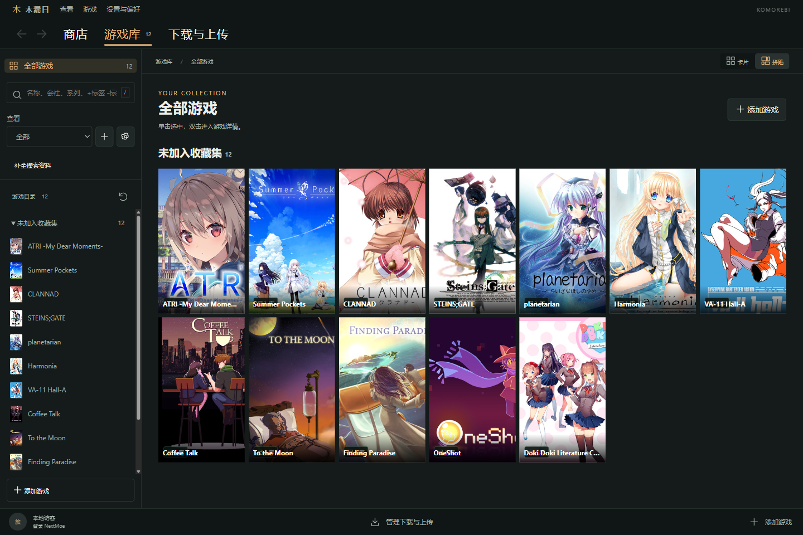
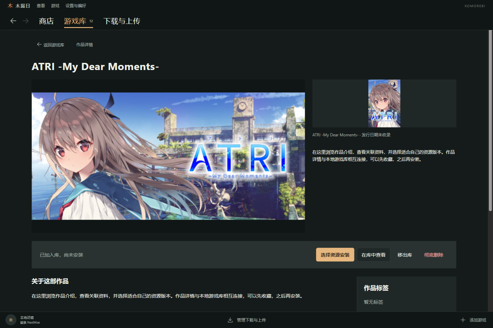
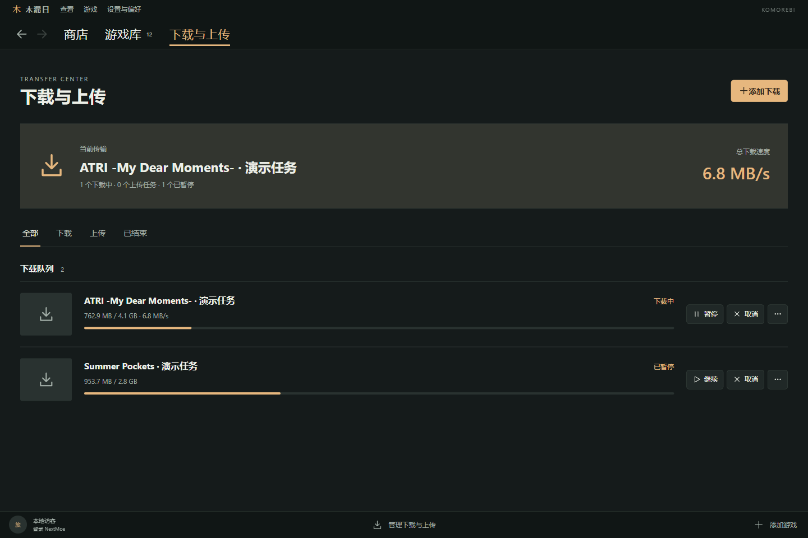
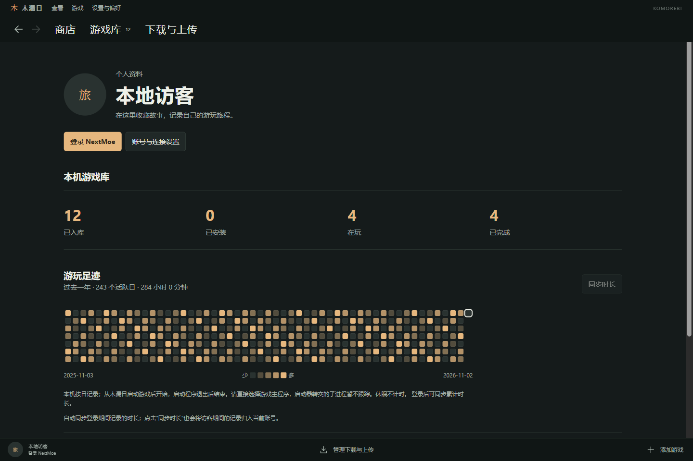

<div align="center">
  
  <h1>木漏日 · Komorebi</h1>
  <p><strong>收藏故事，整理游戏，记录每一次相遇。</strong></p>
  <p>面向 Galgame 与同人游戏玩家的 Windows 游戏管理器</p>
  <p>
    <a href="https://github.com/Minyaako/Komorebi/releases/latest"></a>
    
    <a href="https://developer.nextmoe.dev/docs"></a>
  </p>
  <p><a href="https://github.com/Minyaako/Komorebi/releases/latest"><strong>下载安装</strong></a> · <a href="#界面一览">界面一览</a> · <a href="#已完成的核心功能">核心功能</a> · <a href="#接下来要做的事">后续计划</a> · <a href="https://github.com/Minyaako/Komorebi/issues">反馈问题</a></p>
</div>

## 从 LetsMoe 出发

**木漏日的核心在线能力来自 [LetsMoe（LetMoe·一启萌）](https://www.letmoe.com/) 与 [NextMoe API](https://developer.nextmoe.dev/docs)。** 作品目录、标签、资源服务与账号授权依托它们提供；木漏日把这些能力和本地游戏库、下载管理、游玩记录连接起来，提供一个更适合桌面的使用入口。

感谢平台维护者、资料贡献者和资源分享者。木漏日是独立第三方客户端，与 NextMoe、LetsMoe 无官方隶属关系；作品、封面与资源归各自权利人。

### 一起维护资源环境

好用的客户端离不开持续维护的资源社区。希望大家在使用时，也愿意回到 LetsMoe 参与建设：

- 补充准确的作品名称、会社、标签和版本信息，让后来的玩家更容易找到作品。
- 发现失效链接、错误关联或缺失说明时，反馈问题并协助修正。
- 分享资源时注明来源、语言、版本、解压密码和启动方式；遵守平台规则与作者的分享要求。
- 上传前检查文件完整性，排除自己的存档、账号信息和其他私人文件。

**木漏日不内置游戏资源，也不提供共享账号或共享 API 密钥。** 资源是否可用，以及具体访问权限，以平台和当前账号为准。

## 界面一览

### 全部游戏 · 封面拼贴

让整个游戏库铺展开来。卡片与拼贴可以切换，双击进入游戏详情。



<details>
<summary><strong>作品详情：浏览介绍、系列与可用资源</strong></summary>



</details>

<details>
<summary><strong>下载与上传：集中查看传输任务</strong></summary>



</details>

<details>
<summary><strong>游玩足迹：记录时长与每日活动</strong></summary>



</details>

截图来自应用实际界面，使用独立选取的公开作品和合成演示记录，不读取个人收藏或账号；任务速度、进度及热力图仅用于展示界面。[截图来源](docs/images/SOURCES.md)，游戏封面归各自权利人。

## 已完成的核心功能

| 模块 | v1.0 已实现 |
| --- | --- |
| 🔎 发现作品 | 名称、标签、会社、staff 与系列检索入口；标签包含/排除、排序、直链筛选、连续加载；前进后退保留搜索与滚动位置 |
| 📖 作品详情 | 简介与 Markdown 资源说明、多资源展示、相关系列浏览及一键入库；可先收藏、不下载 |
| 🗂️ 本地游戏库 | 多磁盘游戏库、目录扫描与作品匹配、综合库搜索、状态筛选、手动收藏集；卡片/拼贴与详情视图 |
| ⬇️ 下载与整理 | aria2 下载、暂停续传；直链完成后校验与自动解压、密码重试；网盘目录监听后移入目标位置并标为待操作 |
| ⬆️ 资源投稿 | 官方页面助手辅助填写与上传；游戏目录打包、存档目录及正则排除、启动信息清单 |
| 🕒 个人记录 | OAuth 登录、个人资料、游戏状态、评分与笔记；游玩计时、时长同步与活动热力图 |
| 🖥️ 桌面体验 | 托盘后台运行、单实例恢复、多主题、右键操作、横幅本地缓存；Windows 安装包与开始菜单入口 |

## 接下来要做的事

以下是待完成或继续完善的方向，不代表当前版本已经支持。

- [ ] **继续打磨 UI**：统一间距、字号和图标；完善高 DPI、最大化与窄窗口布局；补齐动效、空状态和键盘操作。
- [ ] **完善资源安装**：支持游戏本体与补丁等复合资源的选择和安装顺序，改进分卷及异常任务恢复体验。
- [ ] **改进搜索与匹配**：增强多语言别名、近似名称和扫描候选排序；结合 NextMoe 实际接口能力探索模糊检索。
- [ ] **提高投稿助手稳定性**：适配官网表单变化，完善中断恢复与失败提示，进一步简化个人密钥申领。
- [ ] **完善游戏计时**：更好地识别启动器拉起的子进程，改进异常退出、跨设备记录与同步冲突的处理。
- [ ] **提升大库体验**：优化大量封面的加载、列表渲染和缓存维护。
- [ ] **完善版本维护**：应用内更新检查、数据导出/恢复和更完整的发布回归。

欢迎带着具体场景提交 [Issue](https://github.com/Minyaako/Komorebi/issues)：在哪个页面、做了什么、希望得到怎样的结果。截图和复现步骤会很有帮助，请先隐藏账号凭据及私人路径。

## 安装与使用

从 [Releases](https://github.com/Minyaako/Komorebi/releases/latest) 下载：

| 文件 | 用途 |
| --- | --- |
| `Komorebi-1.0.0-Setup-x64.exe` | 推荐。中文安装向导，可选安装位置，创建开始菜单启动与卸载入口 |
| `Komorebi-v1.0.0-Windows-x64.zip` | 便携版。完整解压后运行 `Komorebi.exe` |
| `SHA256SUMS.txt` | 下载文件校验值 |

**运行环境为 Windows 10/11 x64，不需要另外安装 Node.js、npm、Electron、aria2 或 7-Zip。** 应用运行时、下载/解压引擎和前端组件已随包提供；请保留完整安装目录。在线检索、登录和资源访问需要网络。网盘目录监听是可选功能，实际网盘下载由用户自己的网盘客户端完成。当前安装包未签名。

1. 打开后可浏览作品，也可扫描已有游戏文件夹。
2. 在设置中登录 NextMoe；需要资源权限时，按引导申领并保存自己的个人密钥。
3. 将作品加入游戏库，选择资源下载或关联本地目录。
4. 关闭主窗口后默认留在托盘，下载与计时继续；彻底退出请使用托盘菜单。

应用数据统一保存在 `%APPDATA%\Komorebi`，游戏库可选择其他磁盘。安装版与便携版共用应用数据；卸载保留游戏与个人记录。旧版本迁移后，一些游戏和历史压缩包仍可能在原目录，请勿直接删除旧 `data` 文件夹。

更多说明见 [使用指南](docs/USAGE.md)。

## 开发与验证

源码开发需要 Windows x64 与 Node.js 22 或更新版本；这些只用于开发，不是最终用户的运行依赖。

```powershell
npm ci
npm start
npm test
npm run test:ui
node scripts/background-test.cjs
```

`npm run package` 生成便携目录，`npm run package:installer` 基于该目录制作安装包。打包脚本拒绝覆盖已有便携发行目录。

v1.0 已通过 57 项功能回归和关键界面测试；安装、开始菜单、后台运行、卸载保留数据均有实测。发行版还在仅保留 Windows 系统 PATH 的环境下验证了界面启动、包内下载与解压流程。

`.gitignore` 排除个人数据、凭据、开发依赖和生成产物；发布前运行 `node scripts/audit-release.cjs` 检查暂存内容，并使用 Gitleaks 扫描提交历史。

## 致谢

- [LetsMoe / LetMoe·一启萌](https://www.letmoe.com/) 与 [NextMoe API](https://developer.nextmoe.dev/docs)：核心在线内容与资源能力。
- [Electron](https://github.com/electron/electron)、[aria2](https://github.com/aria2/aria2)、[7-Zip](https://github.com/ip7z/7zip)：桌面运行、下载与解压。
- [Marked](https://github.com/markedjs/marked) 与 [DOMPurify](https://github.com/cure53/DOMPurify)：资源说明渲染与清理。
- 每一位维护资料、修复链接、提供反馈和分享作品的社区成员。

组件许可证及对应源码说明见 [THIRD_PARTY_NOTICES.md](THIRD_PARTY_NOTICES.md)。
